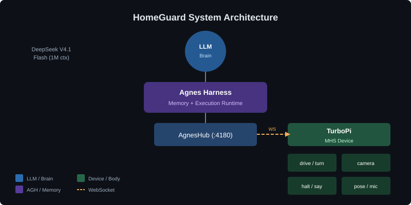
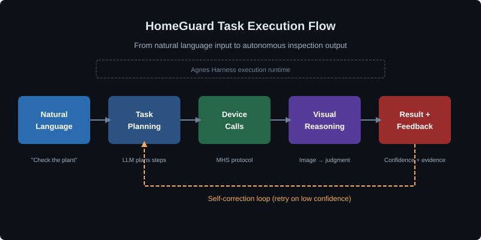
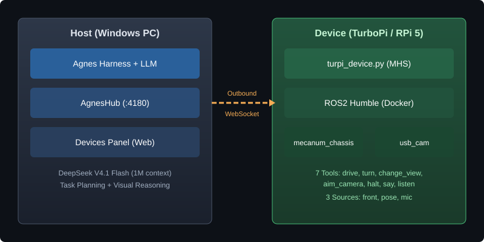

# HomeGuard

English | [简体中文](README.zh-CN.md)

<p align="center">
  
</p>

<div align="center">

### Built for trust. Made for the real world.

**Bring AI into home care. Turn natural language into autonomous inspection tasks.**


[Quickstart](#quickstart) · [Architecture](#architecture) · [Demo Video](#demo-video) · [Integration Standards](#integration-standards) · [Documentation](docs/)

Hackathon Demo · [Source Code](#source-code) · [Apache-2.0](LICENSE)

</div>

> **Competition:** 2026 Jiangsu Province AI+ Science and Engineering Innovation Practice Hackathon (Undergraduate Group)  
> **Team:** Shenlin · Wuxi University · Team ID: U116  
> **Submission Date:** 2026-10-15

<p align="center">
  
</p>

<p align="center">
  <b>Natural language in. Autonomous inspection out.</b><br />
  <sub>One framework for mobile observation, visual reasoning, and closed-loop task execution. <a href="#architecture">See the architecture</a></sub>
</p>

Home service robots are moving from remote control to natural language interaction, but the real bottleneck isn't single-point capability—it's **task closure**. When a user says "check if the balcony plants need watering," the robot must decide where to go, what to observe, how to judge, what to do if uncertain, and how to report back. Most home robots today either rely on pre-programmed fixed workflows or can only complete single-step Q&A, **unable to form a complete "move—observe—reason—verify—feedback" closed loop**.

HomeGuard solves this with a **universal task engine** that accepts natural language task definitions, autonomously completes closed-loop execution, and self-corrects on failure.

<p align="center">
  
</p>

<p align="center"><sub>From natural language to autonomous inspection in one command.</sub></p>

<details>
<summary><kbd>Contents</kbd></summary>

- [Project Overview](#project-overview)
- [Demo Video](#demo-video)
- [Architecture](#architecture)
- [Integration Standards](#integration-standards)
- [Quickstart](#quickstart)
- [Source Code](#source-code)
- [Current Status and Roadmap](#current-status-and-roadmap)
- [Known Limitations](#known-limitations)
- [Community and License](#community-and-license)

</details>

## Project Overview

### What HomeGuard Is

HomeGuard is an **autonomous inspection framework** for home service robots, built on [Agnes Harness](https://github.com/AgnesAI-Labs/agnes-harness) (AGH) and the [MHS device protocol](https://github.com/AgnesAI-Labs/agnes-harness/tree/main/packages/mhs). It demonstrates how a single natural language command can drive a mobile robot to:

1. **Understand the task** — Parse "check if the balcony plants need watering" into executable steps
2. **Plan the execution** — Navigate to the target, observe with cameras, reason about visual state
3. **Handle uncertainty** — Retry with different angles when confidence is low
4. **Report results** — Output structured conclusions with confidence scores and evidence
5. **Self-correct** — Recover from failures (device offline, low confidence, hardware errors)

### Core Features

| Feature | Description | Implementation |
|---|---|---|
| **Natural Language Task Input** | Users describe tasks in plain language; no pre-programmed commands | LLM task planning via Agnes Harness |
| **Autonomous Navigation** | Robot moves to target locations based on task goals | MHS `drive` / `turn` / `change_view` tools |
| **Visual Reasoning** | Camera images enter model context for real-time judgment | MHS `read_device(front)` with `returnsImages` capability |
| **Uncertainty Handling** | Low-confidence judgments trigger re-observation strategies | Structured output with confidence scores; automatic retry |
| **Failure Recovery** | Device errors, offline states, and hardware failures handled gracefully | AGH execution feedback loop; device capability declaration |
| **Closed-Loop Verification** | Cross-validation between visual judgment and sensor readings | Humidity meter readings vs. image-based conclusions |

### Innovation Highlights

**1. First Real Hardware Integration with Agnes Harness MHS**

HomeGuard is the **first documented case** of physical hardware integration with AGH's MHS protocol. The official MHS acceptance scope explicitly excludes physical devices:

> "Real browsers, paid models, external services, **physical devices**, and other platforms were outside this acceptance scope."

This project validates MHS with a real TurboPi robot (Raspberry Pi 5), demonstrating that the protocol works end-to-end in a physical deployment scenario.

**2. Device-Dial Architecture**

Unlike traditional robot control where the host connects to devices, HomeGuard follows MHS's **device-dial** pattern:

- The robot **actively dials** the host's AgnesHub via outbound WebSocket
- The device side opens **no inbound ports** (minimal attack surface)
- All model calls are **validated against device-declared capabilities**
- The model never talks to hardware directly—it acts through AgnesHub

**3. Honest Failure Reporting**

HomeGuard **intentionally preserves hardware limitations** rather than hiding them:

- `aim_camera` (gimbal control) always fails due to insufficient torque—kept in the tool table to honestly report the failure
- `pose` source is marked `ok: false` because odometry drifts without encoders
- Low-voltage protection is disabled in hardware—documented and compensated with manual voltage checks

This approach prioritizes **transparency over polish**, showing real-world deployment challenges rather than a curated demo.

**4. Structured Visual Judgment**

The model outputs **structured judgments** rather than free-text conclusions:

```json
{
  "conclusion": "needs watering",
  "confidence": 0.82,
  "evidence": ["leaves appear slightly wilted", "soil surface looks dry"],
  "retry_recommended": false
}
```

When confidence falls below threshold, the system automatically adjusts camera angle and retries—demonstrating **self-correction under uncertainty**.

## Demo Video

<p align="center">
  <a href="https://www.bilibili.com/video/BV1xxxxxx">
    
  </a>
</p>

> **Demo Video:** [Autonomous Plant Inspection Task](https://www.bilibili.com/video/BV1xxxxxx) (3:40)  
> **Duration:** 3 minutes 40 seconds  
> **Content:** Full task execution from natural language input to structured conclusion

### What the Demo Shows

| Timestamp | Segment | Content |
|---|---|---|
| 0:00–0:30 | **Task Input** | Natural language command: "Find the plant, approach it, check the green humidity meter, determine if it needs watering, without relying on localization" |
| 0:30–1:00 | **Task Planning** | Model calls `list_devices` → `read_device(pose)` to confirm device online and data freshness |
| 1:00–2:00 | **Autonomous Navigation** | Robot moves toward target via `drive` / `turn` / `change_view`; all calls validated by AgnesHub |
| 2:00–2:40 | **Visual Reasoning + Failure** | `read_device(front)` returns real camera image; `aim_camera` fails (gimbal hardware limitation); model degrades to `change_view` |
| 2:40–3:20 | **Result Verification** | Robot reads humidity meter pointer position; outputs structured conclusion with evidence |
| 3:20–3:40 | **Limitations Disclosure** | Honest disclosure: gimbal unavailable, no encoders, low-voltage protection disabled |

### Reproduction

The demo was recorded in a single take (no splicing of unrealized processes). Reproduction steps:

1. Deploy Agnes Harness on Windows host (see [Quickstart](#quickstart))
2. Deploy device program on TurboPi (Raspberry Pi 5)
3. Establish WebSocket connection (device dials host)
4. Input natural language task in AGH session
5. Observe autonomous execution

> **Note:** Video link is a placeholder. Actual video will be uploaded upon competition submission.

## Architecture

<p align="center">
  
</p>

### System Components

| Component | Role | Technology |
|---|---|---|
| **Host (Windows PC)** | Runs Agnes Harness + AgnesHub + LLM; performs task planning and orchestration | Node.js ≥ 24.10, Agnes Harness (source build) |
| **Device (TurboPi)** | Runs device program; declares capabilities; accepts calls | Raspberry Pi 5, Debian 12, ROS2 Humble, Python 3.10+ |
| **LLM** | Task planning + visual reasoning | DeepSeek V4.1 Flash (1M context) |
| **MHS Protocol** | Device communication layer; capability declaration; call validation | Agnes Harness `packages/mhs` |

### Request Flow

```
┌──────────────────────┐         ┌──────────────────────────┐
│  Host (Windows)      │         │  TurboPi (Raspberry Pi 5) │
│                      │         │                          │
│  AGH + LLM           │         │  Docker container        │
│   ├ AgnesHub Plugin  │◄────────┤   ├ turpi_device.py      │
│   │  :4180           │ Outbound│   │  (agnes_mhs library) │
│   └ Devices Panel    │   WS    │   ├ ROS2 Humble          │
│                      │         │   │  ├ mecanum_chassis   │
└──────────────────────┘         │   │  ├ usb_cam           │
                                 │   │  └ web_video_server  │
                                 └──────────────────────────┘
```

**Key Design Decision: Call Direction**

The device **actively dials** the host's AgnesHub—not the other way around. This brings three benefits:

1. **Device opens no inbound ports** — only one outbound WebSocket (minimal attack surface)
2. **Protocol layer handled by AGH** — no glue code needed on the host to "talk to the robot"
3. **Every call validated against device declarations** — device declares capabilities; AGH enforces them

### Core Modules

#### 1. Task Planning (LLM + AGH)

The LLM receives natural language input and plans execution steps:

```
Input: "Check if the balcony plants need watering"
↓
Plan:
  1. list_devices → confirm turpi-01 online
  2. read_device(pose) → check location and battery
  3. call_device(drive, distance=2.0, speed=0.1) → move toward plant
  4. read_device(front) → capture image
  5. Visual reasoning → judge plant state
  6. If confidence < 0.7 → change_view + retry
  7. Output structured conclusion
```

#### 2. Device Capability Declaration (MHS)

The device declares its capabilities to AgnesHub:

| Tool/Source | Type | Description | Status |
|---|---|---|---|
| `drive` | tool | Move forward/backward specified distance (meters) | ✅ Verified |
| `turn` | tool | Rotate in place specified angle (degrees) | ✅ Verified |
| `change_view` | tool | Change camera angle (semantic wrapper for turn) | ✅ Verified |
| `aim_camera` | tool | Gimbal control (hardware lacks torque; **always fails**) | ⚠ Intentional |
| `halt` | tool | Emergency stop | ✅ Verified |
| `say` | tool | Speak text (falls back to beep if no TTS) | ✅ Verified |
| `listen` | tool | Listen for N seconds and report volume | ✅ Verified |
| `front` | source | Camera image (640×480 JPEG) | ✅ Verified |
| `pose` | source | Odometry pose (x, y, yaw, ok) — **`ok: false` (no encoders)** | ✅ Honest |
| `mic` | source | Microphone audio (on-demand recording) | ✅ Verified |

#### 3. Visual Reasoning (LLM + Camera)

Camera images enter the model context via `read_device(front)` with `returnsImages` capability:

```python
# Image capture
read_device(device="turpi-01", sources=["front"])
# → Returns 640×480 JPEG directly in model context

# Model outputs structured judgment
{
  "conclusion": "needs watering",
  "confidence": 0.82,
  "evidence": ["leaves appear slightly wilted", "soil surface looks dry"],
  "retry_recommended": false
}
```

When confidence is low, the system automatically adjusts camera angle and retries:

```python
# Low confidence → retry
change_view(angle=15)  # Rotate 15 degrees
read_device(sources=["front"])  # Re-capture
# → Second judgment with improved confidence
```

#### 4. Execution Feedback Loop (AGH)

Every device call returns structured feedback to the model:

```python
# Successful drive
call_device(device="turpi-01", tool="drive", args={"distance": 0.5, "speed": 0.1})
# → "drove 0.50 m forward. Now at (1, 0.5) facing 0 degrees. Took 5 s."

# Failed gimbal call
call_device(device="turpi-01", tool="aim_camera", args={"pan": 45})
# → Error: "gimbal torque insufficient. Suggestion: use change_view instead."
```

The model reads these results and adjusts strategy accordingly—enabling **closed-loop execution**.

### Deployment Architecture

| Layer | Component | Deployment |
|---|---|---|
| **Host** | Agnes Harness + AgnesHub | Windows PC, Node.js ≥ 24.10 |
| **Host** | LLM API | DeepSeek V4.1 Flash (1M context) |
| **Network** | WebSocket | Device → Host :4180 (outbound from device) |
| **Device** | turpi_device.py | Docker container on Raspberry Pi 5 |
| **Device** | ROS2 stack | mecanum_chassis, usb_cam, web_video_server |

**Security Note:** AgnesHub has **no authentication or encryption** (by design). It must only listen on trusted local networks—**never expose to the public internet**.

## Integration Standards

### MHS Protocol Compliance

HomeGuard integrates with Agnes Harness via the **Model Hardware Standard (MHS)** protocol:

| Standard | Description | Implementation |
|---|---|---|
| **Device Declaration** | Device declares tools, sources, and state to AgnesHub | `turpi_device.py` uses `agnes_mhs` library |
| **Capability Validation** | AgnesHub validates every call against device declarations | Built into AGH runtime |
| **Call Direction** | Device dials AgnesHub (outbound WebSocket) | No inbound ports on device |
| **Tool Interface** | 7 fixed device tools: `list_devices`, `read_device`, `call_device`, `set_device`, `stop_device`, `watch_device`, `unwatch_device` | Model calls via these tools |
| **Source Streaming** | Data sources (camera, pose, mic) stream via `read_device` | `returnsImages` capability for camera |

### API Standards

#### Device Tools (Model-Side)

The model interacts with devices through 7 fixed tools:

```python
# List available devices
list_devices()
# → ["turpi-01"]

# Read device state/sources
read_device(device="turpi-01", sources=["pose", "front"])
# → {pose: {x, y, yaw, ok}, front: <image>}

# Call device tool
call_device(device="turpi-01", tool="drive", args={"distance": 0.5, "speed": 0.1})
# → "drove 0.50 m forward..."

# Stop device (always allowed)
stop_device(device="turpi-01")
# → "halted"
```

#### Device-Side Tools (Hardware-Specific)

The device declares its own tools (passed as parameters to `call_device`):

```python
# Movement
drive(distance: float, speed: float) → str
turn(angle: float) → str

# Camera
change_view(angle: float) → str
aim_camera(pan: float, tilt: float) → str  # Fails on this hardware

# Safety
halt() → str

# Audio
say(text: str) → str
listen(duration: float) → {peak: float, rms: float}
```

### Technical Standards

| Standard | Version | Notes |
|---|---|---|
| **Node.js** | ≥ 24.10 | Required for Agnes Harness |
| **Python** | ≥ 3.10 | Required for `agnes_mhs` |
| **ROS2** | Humble | Required for TurboPi stack |
| **WebSocket** | RFC 6455 | Device ↔ AgnesHub communication |
| **JSON** | RFC 8259 | Tool arguments and responses |

### Integration Checklist

For integrating new devices with HomeGuard:

- [ ] Device program uses `agnes_mhs` library
- [ ] Device declares all tools and sources via `dev.tool()` / `dev.source()`
- [ ] Device dials AgnesHub URL (outbound WebSocket)
- [ ] Device handles `halt` tool (safety requirement)
- [ ] Device declares safety constraints (e.g., low-voltage protection)
- [ ] Device returns structured feedback (success/failure + reason)
- [ ] Camera sources declare `returnsImages` capability (if applicable)

See [MHS documentation](https://github.com/AgnesAI-Labs/agnes-harness/tree/main/packages/mhs) for full protocol specification.

## Quickstart

### Prerequisites

| Component | Requirement | Notes |
|---|---|---|
| **Host OS** | Windows 10/11 or Linux | Tested on Windows 11 |
| **Node.js** | ≥ 24.10 | [Download](https://nodejs.org/) |
| **pnpm** | 10.34.5 | `npm i -g pnpm@10.34.5` |
| **Device** | Hiwonder TurboPi (Raspberry Pi 5) | With ROS2 Humble pre-installed |
| **Network** | Same LAN for host and device | Trusted network only |

### Step 1: Build Agnes Harness (Host)

```bash
git clone https://github.com/AgnesAI-Labs/agnes-harness.git
cd agnes-harness
pnpm install --frozen-lockfile
pnpm --filter @agnes/cli build:local
node packages/cli/dist/local/agnes.mjs --help
```

> **Windows Note:** Windows builds are not officially validated by AGH team. If build fails, consider deploying AGH on the Raspberry Pi itself (Linux).

### Step 2: Install MHS Plugin

```bash
# Install MHS plugin
pnpm --filter @agnes/mhs plugin:install

# Start AGH with Hub
export AGNES_HUB_LISTEN='0.0.0.0:4180'
export AGNES_HUB_ORIGIN='http://127.0.0.1:4180'
node packages/cli/dist/local/agnes.mjs serve --port 4177 --profile local-dev
```

Open browser to `http://127.0.0.1:4177` → Settings → Plugin Management → Enable `@agnes/mhs`.

### Step 3: Deploy Device Program (TurboPi)

```bash
# SSH into TurboPi
ssh pi@192.168.3.187

# Start ROS2 stack (if not running)
bash ~/turbopi_agh/recover.sh

# Check battery voltage
bash ~/tools/bat.sh
# Must be ≥ 7200 mV before proceeding

# Start device program
bash ~/tools/clean_restart.sh
```

Verify device is online:

```python
# In AGH session
read_device(device="turpi-01", sources=["pose"])
# Expected: available, timestamp in seconds
```

### Step 4: Run Task

In AGH web interface, input natural language command:

```
Find the plant, approach it, check the green humidity meter, determine if it needs watering, without relying on localization. Reply in Chinese.
```

Observe autonomous execution:

1. Robot confirms device online
2. Navigates toward target
3. Captures camera image
4. Reasons about plant state
5. Outputs structured conclusion

## Source Code

### Repository Structure

```
homeguard/
├── README.md                    # This file (English)
├── README.zh-CN.md              # Chinese version
├── LICENSE                      # Apache-2.0
├── docs/
│   ├── assets/                  # Images and diagrams
│   ├── guide/
│   │   ├── quickstart.md        # Detailed quickstart guide
│   │   └── deployment.md        # Deployment guide
│   └── develop/
│       ├── architecture.md      # Architecture details
│       └── mhs-integration.md   # MHS integration guide
├── src/
│   ├── turpi_device.py          # Device program (30 KB)
│   ├── car_scripts/             # 25 maintenance scripts
│   ├── car_config/              # Configuration files
│   ├── car_evidence/            # 19 device photos
│   ├── tools/                   # 27 host-side scripts
│   └── docs/                    # 5 technical documents
└── examples/
    └── plant-inspection/        # Example task
```

### Key Files

| File | Description | Size |
|---|---|---|
| `src/turpi_device.py` | Device program (actual running version) | 30,492 bytes |
| `src/tools/bat.sh` | Battery voltage check | — |
| `src/tools/clean_restart.sh` | Clean device restart | — |
| `src/docs/小车接入实测记录.md` | Device integration test log | — |

### Verification

All source code has been verified:

- ✅ Main program MD5 matches running process
- ✅ No credentials (passwords/keys/tokens) in source
- ✅ Declared capabilities match real device
- ✅ Reconnection patches included

## Current Status and Roadmap

### Current Status (Hackathon Demo)

| Feature | Status | Notes |
|---|---|---|
| Natural language task input | ✅ Working | Tested with plant inspection |
| Autonomous navigation | ✅ Working | `drive` / `turn` / `change_view` verified |
| Visual reasoning | ✅ Working | Camera images enter model context |
| Uncertainty handling | ✅ Working | Low-confidence retry demonstrated |
| Failure recovery | ✅ Working | Device offline, hardware errors handled |
| Gimbal control | ❌ Hardware limit | `aim_camera` always fails (insufficient torque) |
| Odometry | ⚠ Unreliable | No encoders; `pose` marked `ok: false` |
| Low-voltage protection | ❌ Disabled | Hardware issue; manual voltage check required |

### Roadmap

| Phase | Goal | Timeline |
|---|---|---|
| **Current** | Plant inspection closed-loop + task switching demo | Hackathon submission (2026-10-15) |
| **Near-term** | Door/window inspection, gas stove check, package delivery reminder | Q4 2026 |
| **Mid-term** | Elderly fall detection, child safety monitoring, pet status check | Q1-Q2 2027 |
| **Long-term** | Proactive home service agent with long-term memory | 2027+ |

## Known Limitations

HomeGuard is a **hackathon demo**, not a production system. Known limitations:

1. **Gimbal unavailable** — Servo accepts position commands but lacks torque to move camera; kept in tool table to honestly report failures
2. **No encoders** — Position estimated via time integration; drifts over time; `pose` source marked `ok: false`
3. **Low-voltage protection disabled** — Hardware issue; robot may run until battery dies; manual voltage check required before each demo
4. **No authentication** — AgnesHub has no auth/encryption; must only run on trusted LAN
5. **Windows build unvalidated** — AGH team has not validated Windows builds; Linux recommended

These limitations are **intentionally documented** rather than hidden. Real-world deployment involves trade-offs; transparency helps others learn from our experience.

## Community and License

### License

HomeGuard is licensed under the [Apache License 2.0](LICENSE).

### Acknowledgments

- [Agnes Harness](https://github.com/AgnesAI-Labs/agnes-harness) — Agent execution runtime and MHS protocol
- [Hiwonder TurboPi](https://www.hiwonder.com/) — Hardware platform and ROS2 stack
- DeepSeek — LLM provider (V4.1 Flash)

### Competition Info

- **Event:** 2026 Jiangsu Province AI+ Science and Engineering Innovation Practice Hackathon
- **Team:** Shenlin (神临) · Wuxi University
- **Team ID:** U116
- **Group:** Undergraduate
- **Members:** Song Luming (Captain), Huang Xiaqi, Tang Yunan

### Contact

For questions about this project:

- **GitHub Issues:** [Open an issue](https://github.com/your-org/homeguard/issues)
- **Competition Forum:** [Agnes AI Forum](https://forum.agnes-ai.cn/)

---

<p align="center">
  <sub>Built with ❤️ by Team Shenlin · Wuxi University · 2026</sub>
</p>
