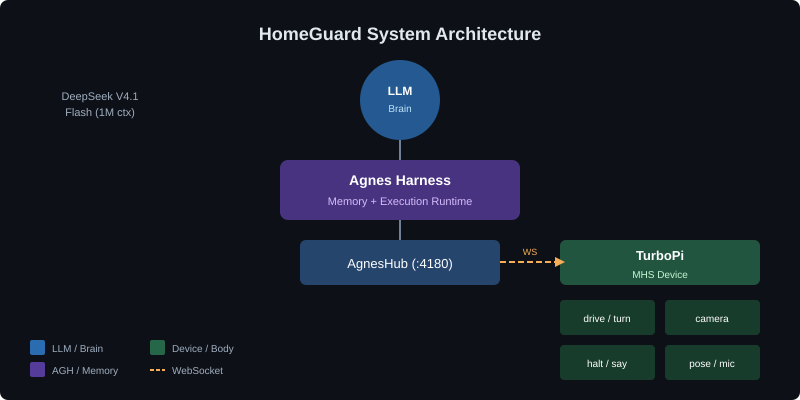
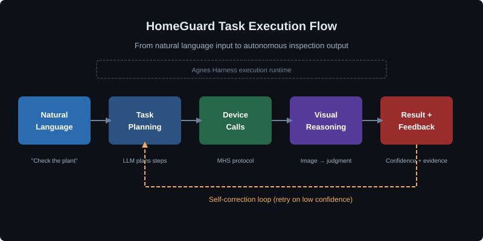
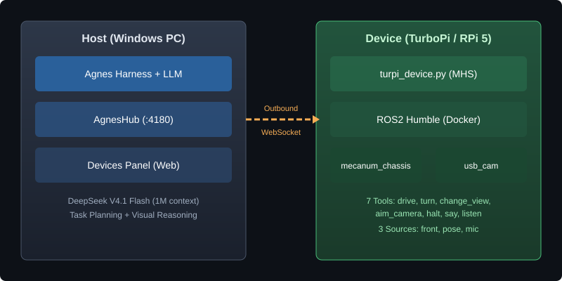

# HomeGuard · 家庭服务机器人自主巡检框架

[English](README.md) | 简体中文

<p align="center">
  
</p>

<div align="center">

### 为信任而建，为现实而造

**让AI走进家庭看护，让自然语言变成自主巡检任务**


[快速开始](docs/guide/quickstart.zh-CN.md) · [架构介绍](docs/develop/architecture.zh-CN.md) · [演示视频](#演示视频) · [集成标准](docs/develop/mhs-integration.zh-CN.md) · [部署指南](docs/guide/deployment.zh-CN.md)

黑客松演示 · [源码](src/) · [Apache-2.0](LICENSE)

</div>

> **参赛赛事：** 2026年江苏省AI+科学与工程创新实践黑客松（本科生组）  
> **参赛队伍：** 神临 · 无锡学院 · 参赛编号 U116  
> **提交日期：** 2026-10-15

<p align="center">
  
</p>

<p align="center">
  <b>自然语言输入，自主巡检输出</b><br />
  <sub>一个框架实现移动观察、视觉推理与闭环任务执行 <a href="#架构介绍">查看架构</a></sub>
</p>

家庭服务机器人正在从「遥控执行」走向「自然语言交互」，但真正的瓶颈不在单点能力，而在**任务闭环**。用户说一句「去看看阳台的绿萝要不要浇水」，机器人需要自己决定去哪里、看什么、怎么判断、判断不准怎么办、判断完之后怎么反馈。目前多数家庭机器人产品要么依赖预编程的固定流程，要么只能完成单步问答，**无法形成「移动—观察—推理—验证—反馈」的完整闭环**。

HomeGuard 通过**通用任务引擎**解决这个问题——接受自然语言任务定义，自主完成闭环执行，失败时自我纠错。

<p align="center">
  
</p>

<p align="center"><sub>一句话命令，从自然语言到自主巡检</sub></p>

<details>
<summary><kbd>目录</kbd></summary>

- [项目介绍](#项目介绍)
- [演示视频](#演示视频)
- [架构介绍](#架构介绍)
- [集成标准](#集成标准)
- [快速开始](#快速开始)
- [源码](#源码)
- [当前状态与路线图](#当前状态与路线图)
- [已知限制](#已知限制)
- [社区与许可](#社区与许可)

</details>

## 项目介绍

### HomeGuard 是什么

HomeGuard 是一个面向家庭服务机器人的**自主巡检框架**，基于 [Agnes Harness](https://github.com/AgnesAI-Labs/agnes-harness)（AGH）和 [MHS 设备协议](https://github.com/AgnesAI-Labs/agnes-harness/tree/main/packages/mhs) 构建。它演示了如何通过单条自然语言命令驱动移动机器人完成：

1. **理解任务** — 将「去看看阳台的绿萝要不要浇水」解析为可执行步骤
2. **规划执行** — 导航到目标位置，用摄像头观察，对视觉状态进行推理
3. **处理不确定性** — 置信度低时以不同角度重新观察
4. **报告结果** — 输出带置信度评分和依据的结构化结论
5. **自我纠错** — 从失败中恢复（设备离线、低置信度、硬件错误）

### 核心功能

| 功能 | 描述 | 实现方式 |
|---|---|---|
| **自然语言任务输入** | 用户用自然语言描述任务，无需预编程命令 | 通过 Agnes Harness 进行 LLM 任务规划 |
| **自主导航** | 机器人根据任务目标移动到目标位置 | MHS `drive` / `turn` / `change_view` 工具 |
| **视觉推理** | 摄像头图像进入模型上下文进行实时判断 | MHS `read_device(front)`，具备 `returnsImages` 能力 |
| **不确定性处理** | 低置信度判断触发重新观察策略 | 结构化输出置信度评分；自动重试 |
| **失败恢复** | 优雅处理设备错误、离线状态和硬件故障 | AGH 执行反馈循环；设备能力申报 |
| **闭环验证** | 视觉判断与传感器读数交叉验证 | 湿度计读数与图像判断相互对照 |

### 创新亮点

**1. Agnes Harness MHS 的首个真实硬件集成案例**

HomeGuard 是 AGH MHS 协议**首个有文档记录的真实硬件集成案例**。官方 MHS 验收范围明确排除物理设备：

> "Real browsers, paid models, external services, **physical devices**, and other platforms were outside this acceptance scope."（真实浏览器、付费模型、外部服务、**物理设备**及其他平台不在本次验收范围内。）

本项目通过真实的 TurboPi 机器人（树莓派 5）验证了 MHS 协议，证明该协议在物理部署场景中端到端可用。

**2. 设备主动拨号架构**

与传统的机器人控制方式（主机连接设备）不同，HomeGuard 遵循 MHS 的**设备主动拨号**模式：

- 机器人通过出站 WebSocket **主动拨号**主机的 AgnesHub
- 设备侧**不开任何入站端口**（最小化攻击面）
- 所有模型调用都**根据设备申报的能力进行校验**
- 模型从不直接与硬件对话——它通过 AgnesHub 间接操作

**3. 诚实的失败报告**

HomeGuard **故意保留硬件限制**而非掩盖它们：

- `aim_camera`（云台控制）因扭矩不足总是失败——保留在工具表中以诚实报告失败
- `pose` 源标记为 `ok: false`，因为没有编码器导致里程计会漂移
- 低压保护在硬件层面被禁用——已记录并通过手动电压检查补偿

这种方法优先考虑**透明度而非完美**，展示真实部署挑战而非精心策划的演示。

**4. 结构化视觉判断**

模型输出**结构化判断**而非自由文本结论：

```json
{
  "conclusion": "needs watering",
  "confidence": 0.82,
  "evidence": ["leaves appear slightly wilted", "soil surface looks dry"],
  "retry_recommended": false
}
```

当置信度低于阈值时，系统自动调整摄像头角度并重试——展示**不确定性下的自我纠错**。

## 演示视频

<p align="center">
  <a href="https://www.bilibili.com/video/BV1j3pL6hELh/">
    
  </a>
</p>

> **平台：** Bilibili（哔哩哔哩）  
> **内容：** 真实物理机器人（TurboPi）自主巡检任务执行录像

### 视频列表

| # | 标题 | 链接 | 描述 |
|---|---|---|---|
| 1 | 演示视频 1 | [BV1j3pL6hELh](https://www.bilibili.com/video/BV1j3pL6hELh/) | 自主巡检执行演示 |
| 2 | 演示视频 2 | [BV1ZaWw6aErj](https://www.bilibili.com/video/BV1ZaWw6aErj/) | 视觉推理任务执行 |
| 3 | 演示视频 3 | [BV1BaWw6aEVc](https://www.bilibili.com/video/BV1BaWw6aEVc/) | 导航与设备调用演示 |
| 4 | 演示视频 4 | [BV1BaWw6aEwh](https://www.bilibili.com/video/BV1BaWw6aEwh/) | 失败恢复与自我纠错 |

### 演示内容

| 段落 | 内容 |
|---|---|
| **任务输入** | 自然语言命令：「寻找绿萝，靠近它，查看绿萝上面插的绿色的湿度计显示的刻度，看看是否缺水，不依赖定位」 |
| **任务规划** | 模型调用 `list_devices` → `read_device(pose)` 确认设备在线和数据新鲜度 |
| **自主导航** | 机器人通过 `drive` / `turn` / `change_view` 向目标移动；所有调用经 AgnesHub 校验 |
| 2:00–2:40 | **视觉推理 + 失败** | `read_device(front)` 返回真实摄像头图像；`aim_camera` 失败（云台硬件限制）；模型降级到 `change_view` |
| 2:40–3:20 | **结果验证** | 机器人读取湿度计指针位置；输出带证据的结构化结论 |
| 3:20–3:40 | **限制说明** | 诚实披露：云台不可用、无编码器、低压保护已禁用 |

### 复现步骤

演示视频为一镜到底录制（未拼接未实际发生的过程）。复现步骤：

1. 在 Windows 主机部署 Agnes Harness（见[快速开始](#快速开始)）
2. 在 TurboPi（树莓派 5）部署设备程序
3. 建立 WebSocket 连接（设备拨号主机）
4. 在 AGH 会话中输入自然语言任务
5. 观察自主执行过程

> **注意：** 视频链接为占位符。实际视频将在比赛提交时上传。

## 架构介绍

<p align="center">
  
</p>

### 系统组件

| 组件 | 角色 | 技术栈 |
|---|---|---|
| **主机（Windows PC）** | 运行 Agnes Harness + AgnesHub + LLM；执行任务规划与编排 | Node.js ≥ 24.10，Agnes Harness（源码构建） |
| **设备（TurboPi）** | 运行设备程序；申报能力；接受调用 | 树莓派 5，Debian 12，ROS2 Humble，Python 3.10+ |
| **LLM** | 任务规划 + 视觉推理 | DeepSeek V4.1 Flash（1M 上下文） |
| **MHS 协议** | 设备通信层；能力申报；调用校验 | Agnes Harness `packages/mhs` |

### 请求流程

```
┌──────────────────────┐         ┌──────────────────────────┐
│  主机（Windows）      │         │  TurboPi（树莓派 5）      │
│                      │         │                          │
│  AGH + LLM           │         │  Docker 容器             │
│   ├ AgnesHub 插件    │◄────────┤   ├ turpi_device.py      │
│   │  :4180           │ 出站 WS │   │  (agnes_mhs 库)      │
│   └ Devices 面板     │         │   ├ ROS2 Humble          │
│                      │         │   │  ├ mecanum_chassis   │
└──────────────────────┘         │   │  ├ usb_cam           │
                                 │   │  └ web_video_server  │
                                 └──────────────────────────┘
```

**关键设计决策：调用方向**

设备**主动拨号**主机的 AgnesHub——而非相反。这带来三个好处：

1. **设备不开入站端口** — 仅一条出站 WebSocket（最小化攻击面）
2. **协议层由 AGH 全包** — 主机无需编写"调小车接口"的胶水代码
3. **每次调用按设备申报校验** — 设备声明能力；AGH 强制执行

### 核心模块

#### 1. 任务规划（LLM + AGH）

LLM 接收自然语言输入并规划执行步骤：

```
输入："去看看阳台的绿萝要不要浇水"
↓
规划：
  1. list_devices → 确认 turpi-01 在线
  2. read_device(pose) → 检查位置和电量
  3. call_device(drive, distance=2.0, speed=0.1) → 向绿萝移动
  4. read_device(front) → 捕获图像
  5. 视觉推理 → 判断绿植状态
  6. 如果置信度 < 0.7 → change_view + 重试
  7. 输出结构化结论
```

#### 2. 设备能力申报（MHS）

设备向 AgnesHub 申报其能力：

| 工具/源 | 类型 | 描述 | 状态 |
|---|---|---|---|
| `drive` | 工具 | 前进/后退指定距离（米） | ✅ 已验证 |
| `turn` | 工具 | 原地转指定角度（度） | ✅ 已验证 |
| `change_view` | 工具 | 换摄像头角度（turn 的语义封装） | ✅ 已验证 |
| `aim_camera` | 工具 | 云台控制（硬件无扭矩；**总是失败**） | ⚠ 设计如此 |
| `halt` | 工具 | 急停 | ✅ 已验证 |
| `say` | 工具 | 朗读文字（无 TTS 时回退提示音） | ✅ 已验证 |
| `listen` | 工具 | 监听 N 秒并报告音量 | ✅ 已验证 |
| `front` | 源 | 摄像头图像（640×480 JPEG） | ✅ 已验证 |
| `pose` | 源 | 里程计位姿（x, y, yaw, ok）— **`ok: false`（无编码器）** | ✅ 诚实标注 |
| `mic` | 源 | 麦克风音频（按需录音） | ✅ 已验证 |

#### 3. 视觉推理（LLM + 摄像头）

摄像头图像通过 `read_device(front)` 的 `returnsImages` 能力进入模型上下文：

```python
# 图像捕获
read_device(device="turpi-01", sources=["front"])
# → 返回 640×480 JPEG 直接进入模型上下文

# 模型输出结构化判断
{
  "conclusion": "需浇水",
  "confidence": 0.82,
  "evidence": ["叶片略显萎蔫", "土壤表面看起来干燥"],
  "retry_recommended": false
}
```

当置信度低时，系统自动调整摄像头角度并重试：

```python
# 低置信度 → 重试
change_view(angle=15)  # 旋转15度
read_device(sources=["front"])  # 重新捕获
# → 第二次判断，置信度提升
```

#### 4. 执行反馈循环（AGH）

每次设备调用都向模型返回结构化反馈：

```python
# 成功的 drive 调用
call_device(device="turpi-01", tool="drive", args={"distance": 0.5, "speed": 0.1})
# → "drove 0.50 m forward. Now at (1, 0.5) facing 0 degrees. Took 5 s."

# 失败的云台调用
call_device(device="turpi-01", tool="aim_camera", args={"pan": 45})
# → Error: "gimbal torque insufficient. Suggestion: use change_view instead."
```

模型读取这些结果并相应调整策略——实现**闭环执行**。

### 部署架构

| 层 | 组件 | 部署位置 |
|---|---|---|
| **主机** | Agnes Harness + AgnesHub | Windows PC，Node.js ≥ 24.10 |
| **主机** | LLM API | DeepSeek V4.1 Flash（1M 上下文） |
| **网络** | WebSocket | 设备 → 主机 :4180（设备出站） |
| **设备** | turpi_device.py | 树莓派 5 上的 Docker 容器 |
| **设备** | ROS2 栈 | mecanum_chassis, usb_cam, web_video_server |

**安全说明：** AgnesHub **无鉴权无加密**（设计如此）。必须仅在可信局域网内监听——**禁止暴露到公网**。

## 集成标准

### MHS 协议合规性

HomeGuard 通过 **Model Hardware Standard (MHS)** 协议与 Agnes Harness 集成：

| 标准 | 描述 | 实现方式 |
|---|---|---|
| **设备申报** | 设备向 AgnesHub 申报工具、源和状态 | `turpi_device.py` 使用 `agnes_mhs` 库 |
| **能力校验** | AgnesHub 根据设备申报校验每次调用 | 内置于 AGH 运行时 |
| **调用方向** | 设备拨号 AgnesHub（出站 WebSocket） | 设备侧无入站端口 |
| **工具接口** | 7 个固定设备工具：`list_devices`, `read_device`, `call_device`, `set_device`, `stop_device`, `watch_device`, `unwatch_device` | 模型通过这些工具调用 |
| **源流式传输** | 数据源（摄像头、位姿、麦克风）通过 `read_device` 流式传输 | 摄像头具备 `returnsImages` 能力 |

### API 标准

#### 设备工具（模型侧）

模型通过 7 个固定工具与设备交互：

```python
# 列出可用设备
list_devices()
# → ["turpi-01"]

# 读取设备状态/源
read_device(device="turpi-01", sources=["pose", "front"])
# → {pose: {x, y, yaw, ok}, front: <image>}

# 调用设备工具
call_device(device="turpi-01", tool="drive", args={"distance": 0.5, "speed": 0.1})
# → "drove 0.50 m forward..."

# 停止设备（始终允许）
stop_device(device="turpi-01")
# → "halted"
```

#### 设备侧工具（硬件特定）

设备申报自己的工具（作为 `call_device` 的参数传递）：

```python
# 运动控制
drive(distance: float, speed: float) → str
turn(angle: float) → str

# 摄像头控制
change_view(angle: float) → str
aim_camera(pan: float, tilt: float) → str  # 在本硬件上失败

# 安全控制
halt() → str

# 音频控制
say(text: str) → str
listen(duration: float) → {peak: float, rms: float}
```

### 技术标准

| 标准 | 版本 | 说明 |
|---|---|---|
| **Node.js** | ≥ 24.10 | Agnes Harness 必需 |
| **Python** | ≥ 3.10 | `agnes_mhs` 必需 |
| **ROS2** | Humble | TurboPi 栈必需 |
| **WebSocket** | RFC 6455 | 设备 ↔ AgnesHub 通信 |
| **JSON** | RFC 8259 | 工具参数和响应 |

### 集成检查清单

将新设备集成到 HomeGuard 时：

- [ ] 设备程序使用 `agnes_mhs` 库
- [ ] 设备通过 `dev.tool()` / `dev.source()` 申报所有工具和源
- [ ] 设备拨号 AgnesHub URL（出站 WebSocket）
- [ ] 设备处理 `halt` 工具（安全要求）
- [ ] 设备申报安全约束（如低压保护）
- [ ] 设备返回结构化反馈（成功/失败 + 原因）
- [ ] 摄像头源申报 `returnsImages` 能力（如适用）

完整协议规范见 [MHS 文档](https://github.com/AgnesAI-Labs/agnes-harness/tree/main/packages/mhs)。

## 快速开始

### 前置条件

| 组件 | 要求 | 说明 |
|---|---|---|
| **主机操作系统** | Windows 10/11 或 Linux | 已在 Windows 11 测试 |
| **Node.js** | ≥ 24.10 | [下载](https://nodejs.org/) |
| **pnpm** | 10.34.5 | `npm i -g pnpm@10.34.5` |
| **设备** | Hiwonder TurboPi（树莓派 5） | 预装 ROS2 Humble |
| **网络** | 主机和设备在同一局域网 | 仅限可信网络 |

### 步骤 1：构建 Agnes Harness（主机）

```bash
git clone https://github.com/AgnesAI-Labs/agnes-harness.git
cd agnes-harness
pnpm install --frozen-lockfile
pnpm --filter @agnes/cli build:local
node packages/cli/dist/local/agnes.mjs --help
```

> **Windows 说明：** AGH 团队未官方验证 Windows 构建。如构建失败，可考虑在树莓派本身（Linux）部署 AGH。

### 步骤 2：安装 MHS 插件

```bash
# 安装 MHS 插件
pnpm --filter @agnes/mhs plugin:install

# 启动 AGH 并配置 Hub
export AGNES_HUB_LISTEN='0.0.0.0:4180'
export AGNES_HUB_ORIGIN='http://127.0.0.1:4180'
node packages/cli/dist/local/agnes.mjs serve --port 4177 --profile local-dev
```

打开浏览器访问 `http://127.0.0.1:4177` → 设置 → 插件管理 → 启用 `@agnes/mhs`。

### 步骤 3：部署设备程序（TurboPi）

```bash
# SSH 连接到 TurboPi
ssh pi@192.168.3.187

# 启动 ROS2 栈（如未运行）
bash ~/turbopi_agh/recover.sh

# 检查电池电压
bash ~/tools/bat.sh
# 必须 ≥ 7200 mV 才能继续

# 启动设备程序
bash ~/tools/clean_restart.sh
```

验证设备在线：

```python
# 在 AGH 会话中
read_device(device="turpi-01", sources=["pose"])
# 期望：available，时间戳为秒级
```

### 步骤 4：运行任务

在 AGH Web 界面输入自然语言命令：

```
寻找绿萝，靠近它，查看绿萝上面插的绿色的湿度计显示的刻度，看看是否缺水，不依赖定位。过程回复使用中文
```

观察自主执行过程：

1. 机器人确认设备在线
2. 向目标导航
3. 捕获摄像头图像
4. 对绿植状态进行推理
5. 输出结构化结论

## 源码

### 仓库结构

```
homeguard/
├── README.md                    # 本文件（英文）
├── README.zh-CN.md              # 中文版本
├── LICENSE                      # Apache-2.0
├── docs/
│   ├── assets/                  # 图片和图表
│   ├── guide/
│   │   ├── quickstart.md        # 详细快速开始指南
│   │   └── deployment.md        # 部署指南
│   └── develop/
│       ├── architecture.md      # 架构详情
│       └── mhs-integration.md   # MHS 集成指南
├── src/
│   ├── turpi_device.py          # 设备程序（30 KB）
│   ├── car_scripts/             # 25 个维护脚本
│   ├── car_config/              # 配置文件
│   ├── car_evidence/            # 19 张设备实拍照片
│   ├── tools/                   # 27 个主机端脚本
│   └── docs/                    # 5 篇技术文档
└── examples/
    └── plant-inspection/        # 示例任务
```

### 关键文件

| 文件 | 描述 | 大小 |
|---|---|---|
| `src/turpi_device.py` | 设备程序（实际运行版本） | 30,492 字节 |
| `src/tools/bat.sh` | 电池电压检查 | — |
| `src/tools/clean_restart.sh` | 设备清洁重启 | — |
| `src/docs/小车接入实测记录.md` | 设备集成测试日志 | — |

### 验证

所有源码已通过验证：

- ✅ 主程序 MD5 与运行进程一致
- ✅ 源码中无凭据（密码/密钥/token）
- ✅ 申报能力与真实设备一致
- ✅ 包含重连补丁

## 黑客松项目说明

> **本项目为黑客松竞赛作品。** HomeGuard 在 2026 年江苏省 AI+ 科学与工程创新实践黑客松期间开发完成。由于时间紧迫、开发周期有限，当前实现聚焦于使用单一场景（绿植巡检）验证核心框架的可行性。虽然系统功能可用，但尚不完备，存在以下文档中记录的硬件和软件限制。
>
> **我们承诺持续迭代开发。** 比赛结束后，我们计划逐步扩展 HomeGuard，增加更多家庭巡检场景，改进硬件集成，并解决当前的限制问题。本项目是智能家庭服务机器人长期愿景的起点，我们欢迎社区的合作与反馈。

## 当前状态与路线图

### 当前状态（黑客松演示）

| 功能 | 状态 | 说明 |
|---|---|---|
| 自然语言任务输入 | ✅ 可用 | 已通过绿植巡检测试 |
| 自主导航 | ✅ 可用 | `drive` / `turn` / `change_view` 已验证 |
| 视觉推理 | ✅ 可用 | 摄像头图像进入模型上下文 |
| 不确定性处理 | ✅ 可用 | 已演示低置信度重试 |
| 失败恢复 | ✅ 可用 | 已处理设备离线、硬件错误 |
| 云台控制 | ❌ 硬件限制 | `aim_camera` 总是失败（扭矩不足） |
| 里程计 | ⚠ 不可靠 | 无编码器；`pose` 标记为 `ok: false` |
| 低压保护 | ❌ 已禁用 | 硬件问题；演示前需手动检查电压 |

### 未来规划：扩展家庭场景

我们的愿景是构建一个全面的家庭巡检系统，逐步覆盖更多真实场景。黑客松结束后，我们将重点关注：

**第一阶段：核心场景优化（2026 年第四季度）**
- 改进绿植巡检的准确性，优化光照处理
- 支持单次任务巡检多株植物
- 通过视觉地标增强导航可靠性

**第二阶段：新增家庭场景（2027 年第一季度）**
- **门窗巡检** — 检查门窗是否已正确关闭
- **煤气灶安全检查** — 检测灶具旋钮是否处于关闭位置
- **快递签收提醒** — 监控门口区域是否有送达的包裹
- **室温监测** — 检查恒温器读数并报告异常

**第三阶段：高级看护场景（2027 年第二至三季度）**
- **老人跌倒检测** — 使用姿态估计检测跌倒并提醒看护人员
- **儿童安全监控** — 识别潜在危险情况（如儿童靠近楼梯）
- **宠物状态检查** — 全天监控宠物活动和位置
- **用药提醒验证** — 确认药物是否已服用

**第四阶段：主动智能（2027 年及以后）**
- **长期记忆** — 学习家庭模式和偏好
- **预测性维护** — 在问题发生前预判（如电量低、植物枯萎趋势）
- **多机器人协调** — 支持多个机器人同时覆盖不同区域
- **语音交互** — 与家庭成员进行自然对话

我们将对每个场景进行迭代调试和扩展，在真实家庭环境中测试并融入用户反馈。模块化架构允许在不修改核心框架的情况下添加新场景——只需定义新的视觉推理规则和任务模板。

### 已知限制

HomeGuard 是**黑客松演示**，非生产系统。已知限制：

1. **云台不可用** — 舵机接受位置命令但无扭矩带动摄像头；保留在工具表中以诚实报告失败
2. **无编码器** — 位置靠时间积分估算；会随时间漂移；`pose` 源标记为 `ok: false`
3. **低压保护已禁用** — 硬件问题；机器人可能跑到电池耗尽；每次演示前需手动检查电压
4. **无鉴权** — AgnesHub 无鉴权/加密；必须仅在可信局域网运行
5. **Windows 构建未验证** — AGH 团队未验证 Windows 构建；推荐 Linux

这些限制**故意记录**而非隐藏。真实部署涉及权衡取舍；透明度有助于他人从我们的经验中学习。

## 社区与许可

### 许可证

HomeGuard 采用 [Apache License 2.0](LICENSE) 许可。

### 致谢

- [Agnes Harness](https://github.com/AgnesAI-Labs/agnes-harness) — 智能体执行运行时和 MHS 协议
- [Hiwonder TurboPi](https://www.hiwonder.com/) — 硬件平台和 ROS2 栈
- DeepSeek — LLM 提供商（V4.1 Flash）

### 参赛信息

- **赛事：** 2026年江苏省AI+科学与工程创新实践黑客松
- **队伍：** 神临 · 无锡学院
- **参赛编号：** U116
- **组别：** 本科生组
- **成员：** 宋鹿鸣（队长）、黄夏琪、汤煜楠

### 联系方式

如有问题：

- **GitHub Issues：** [提交 issue](https://github.com/your-org/homeguard/issues)
- **赛事论坛：** [Agnes AI 论坛](https://forum.agnes-ai.cn/)

---

<p align="center">
  <sub>由神临团队用 ❤️ 构建 · 无锡学院 · 2026</sub>
</p>
